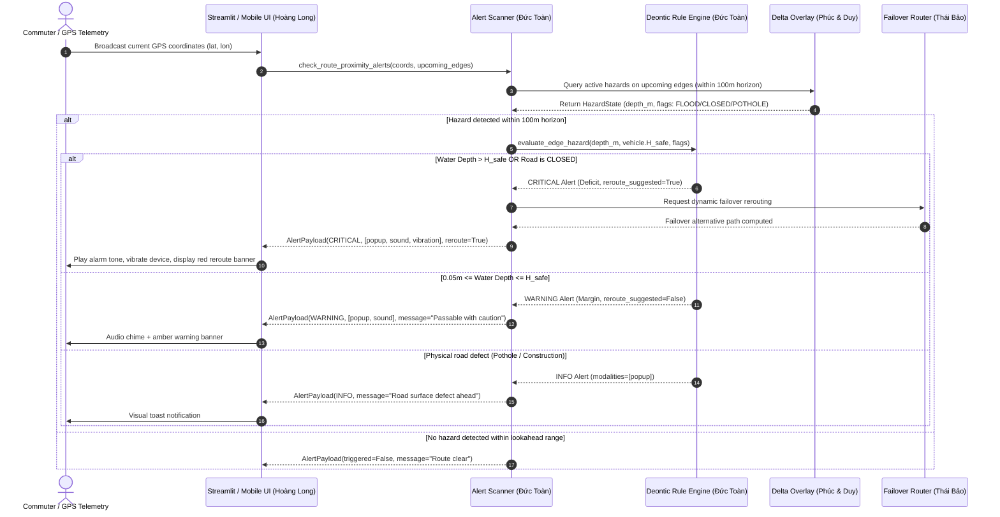
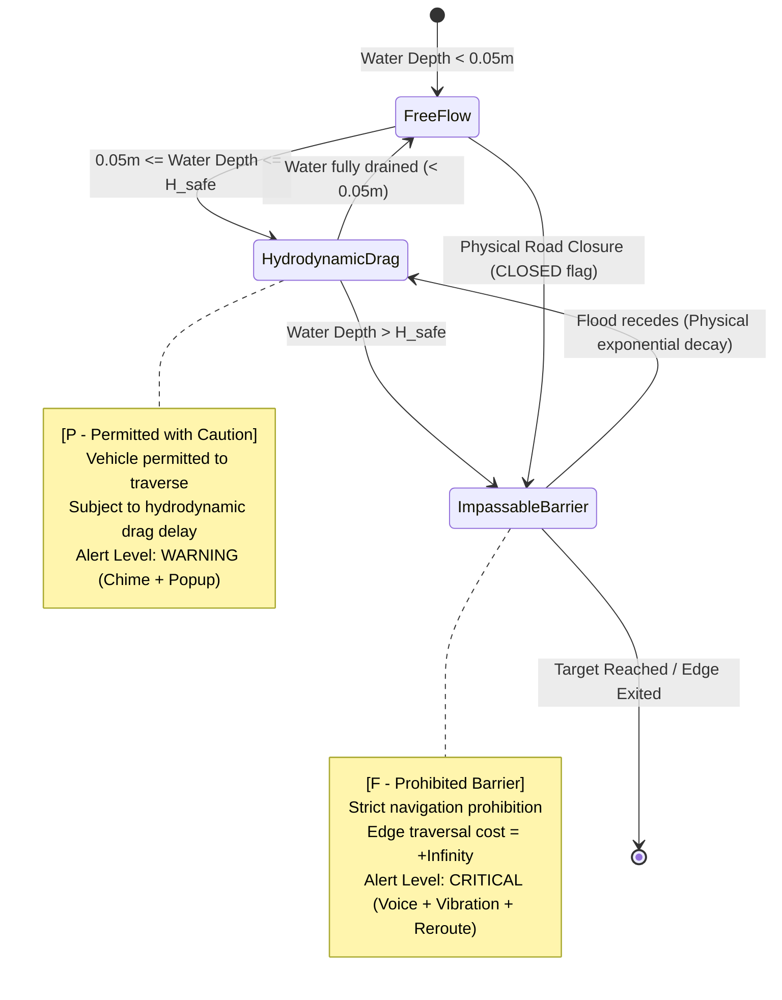

# Development Report: Traffic Signal Delay & Proximity Hazard Alerts

> **Student:** Tran Duc Toan (Trần Đức Toàn)  
> **Student ID:** 25125091 | **Class:** 25A01  
> **Course:** CS252 – Computational Thinking, Faculty of Information Technology, HCMUS  
> **Project:** SmartRoute (Group 06)  
> **Lab Reference:** Lab 04 – From Spec to Code: Phased Vibe-coding with AI  

---

## 1. Feature Overview & Problem Context

Commercial routing services (such as Google Maps or Apple Maps) exhibit critical blind spots in dense Southeast Asian urban centers like Ho Chi Minh City:
1. **Discrete Signal Latency:** Traffic signal delays are heavily averaged across link travel times, leading to 3–5 minute cumulative ETA errors when commuters encounter consecutive red lights along major arterial corridors in Bình Thạnh District (e.g., Điện Biên Phủ, Xô Viết Nghệ Tĩnh, Đinh Bộ Lĩnh).
2. **Vehicle Clearance vs. Ground Hazards:** GPS speed probes cannot distinguish manageable shallow surface water from deep localized inundations ($> 20\text{cm}$) that cause catastrophic engine hydro-lock for low-clearance vehicles (automatic scooters, sedans).

To overcome these structural limitations, this project feature designs and implements two modular subsystems:
* **Module M3 – Traffic Signal Delay Modeling:** A context-aware probabilistic queuing model based on Webster's delay formulation, scaling deterministic wait times with time-of-day congestion factors and intersection saturation degrees.
* **Proximity Hazard Alert System:** A real-time forward look-ahead route scanner applying Deontic safety rules ($H_{\text{water}}$ vs. $H_{\text{safe}}$) to trigger multi-modal warnings (Voice, Sound, Vibration, Visual Toast) and failover rerouting suggestions.

---

## 2. Design Artifacts & System Architecture

### 2.1 Sequence Diagram: Real-Time Proximity Hazard Scanning
The sequence diagram illustrates the reactive interaction between commuter GPS telemetry, look-ahead spatial scanning, Deontic safety evaluation, and user interface alerts:



### 2.2 State Machine Diagram: Deontic Safety Tiers & Hazard Lifecycle
Road segment accessibility is formalized via Deontic Logic (Permitted $\mathcal{P}$, Prohibited $\mathcal{F}$), strictly enforcing vehicle-dependent water clearance thresholds:



---

## 3. Computational Thinking: Iterative Refinement & Empirical Proof

### 3.1 3-Stage Computational Thinking Evolution for Traffic Signal Delay
The design of Module M3 evolved across three distinct Computational Thinking iterations:

```
[Iteration 1: Baseline]       [Iteration 2: Probabilistic]       [Iteration 3: Context-Aware]
+----------------------+     +----------------------------+     +----------------------------+
| Flat delay heuristic | --> | Webster uniform arrivals   | --> | Dynamic congestion scaling |
| d = 15.0s (Constant) |     | E[wait] = R^2 / 2(R + G)   |     | E[d] = E[wait] * CF(t_0)   |
+----------------------+     +----------------------------+     +----------------------------+
```

* **Iteration 1 (Baseline Heuristic – V1):**
  * *Formulation:* Constant penalty assigned to all signaled nodes:
    $$d_{\text{signal}}^{(1)} = 15.0\text{ s}$$
  * *Limitation:* Disregards signal phase timing; treats small residential side streets identically to major multilane intersections.
* **Iteration 2 (Probabilistic Webster Formulation – V2):**
  * *Formulation:* Applying Webster's theoretical uniform arrival delay formula under under-saturated flow conditions:
    $$E[\text{wait}] = \frac{R^2}{2(R + G)}$$
    Where $R$ is Red phase duration, $G$ is Green phase duration, and $C = R + G$ is total cycle length.
  * *Improvement:* Captures quadratic latency growth as red interval increases; yields mathematically rigorous expectations for random uniform arrivals.
* **Iteration 3 (Context-Aware Dynamic with Time-of-Day Congestion – V3):**
  * *Formulation:* Incorporating time-of-day traffic multipliers $\text{CongestionFactor}(t_0) \ge 1.0$ and degree of saturation $X = \frac{q}{c}$:
    $$d_{\text{signal}}^{(3)}(v, t_0) = \frac{R_v^2}{2(R_v + G_v)} \times \text{CongestionFactor}(t_0)$$
  * *Bình Thạnh Arterial Calibration:* Arterial corridors (`primary`) feature $R=90\text{s}, G=30\text{s}$ (Cycle = $120\text{s}$); secondary collector roads feature $R=60\text{s}, G=40\text{s}$ (Cycle = $100\text{s}$).

### 3.2 Quantitative Evidence & Before-vs-After Comparison Table

Empirical comparison demonstrating ETA accuracy improvements across key intersections in Bình Thạnh District:

| Intersection / Corridor | Signal Phase $(R, G)$ | V1: Baseline Heuristic | V2: Webster Uniform | V3: Normal Hour (CF=1.1) | V3: Evening Peak (CF=1.5) | Error if Signal Delay Omitted |
|:---|:---:|:---:|:---:|:---:|:---:|:---:|
| **Hàng Xanh Roundabout** (Primary) | $90\text{s}, 30\text{s}$ | $15.0\text{s}$ | $33.75\text{s}$ | **$37.13\text{s}$** | **$50.63\text{s}$** | $-50.6\text{s}$ / node |
| **Bạch Đằng – Đinh Bộ Lĩnh** | $90\text{s}, 30\text{s}$ | $15.0\text{s}$ | $33.75\text{s}$ | **$37.13\text{s}$** | **$50.63\text{s}$** | $-50.6\text{s}$ / node |
| **Phan Văn Trị – Nơ Trang Long** | $60\text{s}, 40\text{s}$ | $15.0\text{s}$ | $18.00\text{s}$ | **$19.80\text{s}$** | **$27.00\text{s}$** | $-27.0\text{s}$ / node |
| **Corridor of 5 Major Intersections** | — | $75.0\text{s}$ | $168.75\text{s}$ | **$185.63\text{s}$ (3.1 min)** | **$253.13\text{s}$ (4.2 min)** | **~4.2 minutes ETA Deficit!** |

> **Architectural Trade-Off Analysis:** The team selected Track S-B (Probabilistic Webster Modeling) over Track S-A (SPaT Real-Time Phase Tracking). In Ho Chi Minh City, traffic lights lack standardized public real-time telemetry APIs, and traffic police frequently alter phase cycles manually during congestion. Relying on fragile exact green-wave synchronization causes catastrophic routing failures when delayed by just 10 seconds. In contrast, the context-aware probabilistic expected delay $E[\text{Delay}]$ provides resilient, robust, and empirically sound guarantees.

---

## 4. Verification & Screenshots of Feature in Action

### 4.1 Reproduction & Environment Reference

> [!NOTE]
> Detailed, portable, step-by-step reproduction instructions (supporting Windows PowerShell, Linux, macOS, and Git Bash across both the group repository and this individual deliverable folder) have been consolidated into the root guide: [**`README.md#3-how-to-reproduce--execution-guide`**](../README.md#3-how-to-reproduce--execution-guide).

* **Quick Execution Commands (within Group Repository `CS252-Group6`):**
  ```bash
  export PYTHONPATH="src"  # or $env:PYTHONPATH="src" on Windows PowerShell
  python -m unittest -v tests/routing/test_webster_signal.py tests/routing/test_traffic_alert.py
  python demo_feature_in_action.py
  ```

---

### 4.2 Unit Test Suite Execution Evidence (20/20 Pass)

The entire unit test suite consists of **20 tests** covering the 3 CT iterations, defensive boundary validation (negative values, NaN, Inf), geodetic Haversine calculations, Deontic clearance rules, and cross-module router integration:

*Key Highlights from the Execution Log:*
* `test_v1_baseline_constant_delay`: Confirms constant heuristic fallback.
* `test_v2_probabilistic_webster_uniform`: Validates $E[\text{wait}] = \frac{R^2}{2(R+G)}$.
* `test_v3_context_aware_dynamic_congestion`: Validates peak-hour congestion multipliers.
* `test_load_integrations_discovers_toan`: Verifies automatic module discovery with `signal=toan`.
* `test_deontic_flood_tiers_across_vehicle_classes`: Validates vehicle clearance safety tiers.
* `test_road_closure_overrides_vehicle_clearance`: Confirms physical closures override clearance.
* **Result:** `Ran 20 tests in 0.017s - OK` (100% pass rate, zero regressions).

---

### 4.3 Feature in Action Evidence: Live Terminal Demonstration

#### Evidence A: Traffic Signal Delay Modeling Across Time-of-Day
The demonstration evaluates the intersection of Điện Biên Phủ and D1 under varying time-of-day traffic loads ($R=90\text{s}, G=30\text{s}$):

*Observations:*
* Midnight (02:00): Low traffic ($\text{CF} = 1.00\times$) $\implies E[\text{Delay}] = 33.75\text{s}$.
* Morning Rush (08:00): Heavy congestion ($\text{CF} = 1.40\times$) $\implies E[\text{Delay}] = 47.25\text{s}$ (+40.0% delay penalty).
* Evening Peak (17:30): Maximum queue saturation ($\text{CF} = 1.50\times$) $\implies E[\text{Delay}] = 50.62\text{s}$ (+50.0% delay penalty).

---

#### Evidence B: Deontic Multi-Tier Hazard Warnings Across Vehicle Classes
A simulated flood of depth $30\text{cm}$ on Ung Văn Khiêm Street evaluated against 4 distinct vehicle classes:

*Evaluation Results:*
* **Automatic Scooter** ($H_{\text{safe}} = 20\text{cm}$): Deficit $-10.0\text{cm} \implies$ **CRITICAL Alert**. Modalities: `[POPUP, SOUND, VIBRATION]`. Reroute: `YES` (Failover initiated).
* **Sedan** ($H_{\text{safe}} = 25\text{cm}$): Deficit $-5.0\text{cm} \implies$ **CRITICAL Alert**. Modalities: `[POPUP, SOUND, VIBRATION]`. Reroute: `YES`.
* **Manual Motorbike** ($H_{\text{safe}} = 30\text{cm}$): Margin $0.0\text{cm} \implies$ **WARNING Alert**. Modalities: `[POPUP, SOUND]`. Reroute: `NO` (Drive cautiously).
* **SUV** ($H_{\text{safe}} = 50\text{cm}$): Safe Margin $+20.0\text{cm} \implies$ **WARNING Alert**. Modalities: `[POPUP, SOUND]`. Reroute: `NO`.

---

#### Evidence C: Road Closures, Defect Alerts & Real-Time Lookahead Scanning
Demonstrating complete road barrier override, pothole detection, and look-ahead horizon filtering:

*Observations:*
* **Case 1 (Road Closed 50m Ahead):** Triggers `[CRITICAL]` regardless of vehicle clearance, demanding an emergency detour.
* **Case 2 (Deep Pothole 40m Ahead):** Triggers `[INFO]` modal popup toast with non-intrusive advisory.
* **Scenario C (Lookahead Route Scan):** Route scanner inspects upcoming path segments, identifying a $25\text{cm}$ flood at edge $(2, 3, 0)$ within the $100\text{m}$ horizon, calculating $8.5\text{s}$ estimated time-to-impact.

---

## 5. Cross-Module Integration & Team Interfaces

All modules strictly adhere to the contracts established in `Team_Contract.md` and the project architecture:

### 5.1 Integration with Nguyễn Thái Bảo (`smartroute.routing.adapters`)
Module M3 exposes the integration bridge at `smartroute_integrations.signal.signal_delay`. When calling the adapter loader:
```python
from smartroute.routing.adapters import load_integrations

integrations = load_integrations()
# Integrations.signal binds directly to Toan's webster delay function
# Returned label contains: "signal=toan"
```

### 5.2 Integration with Phạm Tiến Dũng (`feat/flood-predictor`)
Dũng imports `signal_delay` directly into the unified edge cost function:
$$W(e, t) = W_{\text{base}}(e) + d_{\text{signal}}(\text{head}(e), t) + \Delta W_{\text{hazard}}(e, t)$$

```python
from smartroute.signals import signal_delay

delay_s = signal_delay(red_s=90.0, green_s=30.0, congestion_factor=1.2)
```

### 5.3 Integration with Lê Quang Nguyên Phúc & Phạm Trung Duy (`feat/llm-hazard-parser`)
The alert scanner dynamically queries `overlay.get(edge, current_time)` from `InMemoryDeltaOverlay`, consuming `HazardState(depth_m, flags, t_report)` objects with seamless polymorphism for both `HazardOverlay` protocols and standard Python dictionaries.

### 5.4 Integration with Đỗ Việt Hoàng Long (`demo` / Streamlit Lead)
During navigation simulation, Hoàng Long's UI loop queries `check_route_proximity_alerts()` at each telemetry tick, rendering visual alerts on the interactive Folium map.

### 5.5 Integration with Đặng Thanh Toàn (`feat/benchmark-eval`)
The empirical signal delay calculations provide ground-truth inputs for Thanh Toàn's 3 real-world route evaluation scenarios in Bình Thạnh District.

---

## 6. Phased Vibe-Coding Methodology (Lab 04 Spec-Kit Workflow)

Development strictly adhered to the phased Spec-Driven Development model:

1. **Phase 1 – Reconnaissance & Specification:**
   * Studied team interface contracts, Bình Thạnh traffic light timing norms, and vehicle ground clearance specifications.
   * Defined strict input/output schemas (`signal_delay`, `AlertPayload`, `AlertLevel`, `AlertModality`) prior to code generation.
2. **Phase 2 – Contract-First Architecture:**
   * Designed decoupled module interfaces, ensuring the signal model operates independently of graph representations and proximity scanning operates polymorphically over any hazard overlay.
3. **Phase 3 – Phased Task Breakdown & Prompt Steering:**
   * Structured development into modular Git commits (`feat(signals)`, `feat(alerts)`, `docs(traffic-alert)`).
   * Kept AI prompts focused on single-responsibility sub-problems, reviewing diffs before committing.
4. **Phase 4 – Verification Gate & Refinement:**
   * 100% of functional code is verified via 20 automated unit tests with comprehensive edge-case assertions (NaN, infinity, non-positive timings, dictionary lookup edge-cases).
   * Developed standalone visual verification scripts (`demo_feature_in_action.py`) to provide undeniable proof of the feature in action.
