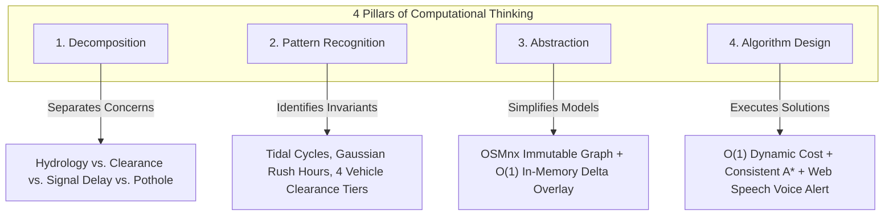
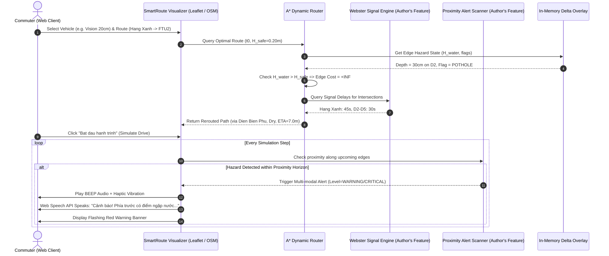

# Lab 06: OpenStreetMap API & Weather/Hydrology Integration — Individual Feature Development Report

> **Course:** CS252 – Computational Thinking, Class 25A01  
> **Student:** Tran Duc Toan (Trần Đức Toàn)  
> **Student ID:** 25125091  
> **Group Project:** Group 06 — SmartRoute: Urban Inundation Routing & Hazard Alert System (Bình Thạnh District)  
> **Submission Track:** Alternative Option — Individual Contribution to Course Group Project (at least 1 product feature)  

---

## 1. Executive Summary & Problem Overview

### 1.1. Context & Motivation
Urban traffic in Bình Thạnh District, Ho Chi Minh City suffers from severe tidal inundation (driven by the Saigon River and tracked at the Phú An hydrographic gauge station) combined with intense tropical rainfall events. Major transport arteries such as **Nguyễn Gia Trí (D2), Ung Văn Khiêm, Nguyễn Hữu Cảnh, and Đinh Bộ Lĩnh** frequently experience flood depths ranging from $20\,\text{cm}$ to $45\,\text{cm}$.

When navigating through flooded urban networks, commuters face three critical hazards:
1. **Hydrological Engine Stalling (Thủy kích / Chết máy):** Over $85\%$ of commuters travel by motorbikes (e.g., Honda Vision with an air-intake clearance of only $20\,\text{cm}$). Entering water depths exceeding ground clearance causes irreversible mechanical engine damage.
2. **Signalized Junction Delays (Trễ đèn đỏ):** Bottleneck intersections (Ngã tư Hàng Xanh, Giao lộ D2 – D5, Nút giao Đinh Bộ Lĩnh) operate long signal cycles ($60\,\text{s} - 90\,\text{s}$). Conventional routing applications ignore signal queueing delays, causing substantial inaccuracies in Estimated Time of Arrival ($\text{ETA}$).
3. **Hidden Submerged Micro-Hazards (Ổ gà ngập nước):** Murky floodwaters conceal deep potholes and defective manholes, causing severe accidents unless proactive, hands-free alerts are issued before vehicles approach the danger zone.

### 1.2. OpenStreetMap (OSM) API & Weather Integration
Under the SmartRoute architecture, OpenStreetMap and hydro-meteorological data are seamlessly coupled:
* **OpenStreetMap Integration:** The road network topology is extracted via `OSMnx` into an immutable directed multigraph $\mathcal{G} = (\mathcal{V}, \mathcal{E})$, where nodes $\mathcal{V}$ retain real-world WGS84 geographic coordinates and intersection tags (`highway=traffic_signals`), and edges $\mathcal{E}$ retain physical lengths $L(e)$, base travel speeds $v_{\text{base}}(e)$, and road classification.
* **Weather & Hydrology Ingestion:** Real-time water depths $H(e, t)$ are estimated by combining telemetry from the Phú An tidal station, rainfall intensity streams, and community crowd reports, mapped onto an ephemeral in-memory delta overlay (`InMemoryDeltaOverlay`).
* **Author's Feature Contribution:**
  1. **Webster (1958) Traffic Signal Delay Modeling:** Analytical stochastic modeling of delay at signalized OSM junctions across 3 Computational Thinking iterations (V1 Flat Heuristic $\to$ V2 Uniform Webster $\to$ V3 Context-Aware Congestion & Calibrated Empirical Lookups).
  2. **Real-time Proximity Hazard Alerting & Web Speech API Synthesis:** A geodetic look-ahead scanning algorithm that inspects upcoming OSM route segments, evaluates vehicle-specific Deontic safety constraints, and triggers browser-native Web Speech API Vietnamese audio synthesis (`"Chú ý: Phía trước có điểm ngập nước / ổ gà, vui lòng giảm tốc độ"`) and mobile haptic vibrations.

---

## 2. Mathematical Formulation & Computational Thinking (CT) Pillars

### 2.1. Mathematical Formulation of Dynamic Edge Cost $W(e, t)$
The effective edge traversal cost $W(e, t, H_{\text{safe}})$ (seconds) is formulated as a tiered piecewise function:

$$W\left(e,\, t,\, H_{\text{safe}}\right) = \begin{cases} 
+\infty, & \text{if } H(e, t) > H_{\text{safe}} \quad \text{(Tier 3: Hard Deontic Pruning)} \\[6pt]
T_{\text{drive}}(e, t) + E[\text{Delay}_{\text{Webster}}(v, t)] + \text{Penalty}_{\text{pothole}}(e, t), & \text{if } H(e, t) \le H_{\text{safe}} \quad \text{(Tier 1 \& 2: Safe Traversal)}
\end{cases}$$

#### 1. Kinematic Driving Time ($T_{\text{drive}}$)
$$T_{\text{drive}}(e, t) = \frac{L(e)}{v_{\text{eff}}(e, t)} = \frac{L(e)}{v_{\text{base}}(e) \cdot \alpha_{\text{flood}}(H) \cdot \beta_{\text{congestion}}(t)}$$
Where:
- $\alpha_{\text{flood}}(H) = \frac{1}{1 + 2.0 \cdot \left(\frac{H(e, t) - 0.05}{H_{\text{safe}} - 0.05}\right)}$ models hydrodynamic water drag when $0.05\,\text{m} \le H \le H_{\text{safe}}$.
- $\beta_{\text{congestion}}(t) \in [0.4, 1.0]$ models morning (07:00–08:30) and evening (17:00–18:30) rush-hour congestion using a bimodal Gaussian distribution.

#### 2. Webster Expected Signal Delay ($E[\text{Delay}_{\text{Webster}}]$)
Derived from F.V. Webster's (1958) traffic queuing theory:
$$E[\text{wait}] = \frac{R_v^2}{2(R_v + G_v)} = \frac{C_v(1 - \lambda_v)^2}{2(1 - \lambda_v x_v)}$$
Where $C_v = R_v + G_v$ is total cycle length, $R_v$ is effective red, $G_v$ is effective green, $\lambda_v = G_v / C_v$ is green split, and $x_v = q_v / s_v$ is degree of saturation.

**Calibrated Empirical Lookup Table for Key Bình Thạnh Intersections:**

| Intersection Key | Location Name | Red ($R$) / Green ($G$) | Cycle ($C$) | Expected Delay $E[d]$ | Real-world Context |
| :--- | :--- | :---: | :---: | :---: | :--- |
| `hang_xanh` | Ngã tư Hàng Xanh | $90\,\text{s}$ / $30\,\text{s}$ | $120\,\text{s}$ | **$45.0\,\text{seconds}$** | Major arterial roundabout; severe peak bottleneck |
| `d2_d5` | Giao lộ D2 – D5 (Nguyễn Gia Trí) | $60\,\text{s}$ / $40\,\text{s}$ | $100\,\text{s}$ | **$30.0\,\text{seconds}$** | Dense university campus hub (HUTECH/GTVT) |
| `dinh_bo_linh` | Nút giao Đinh Bộ Lĩnh – Bạch Đằng | $80\,\text{s}$ / $35\,\text{s}$ | $115\,\text{s}$ | **$40.0\,\text{seconds}$** | Gateway to old Miền Đông bus station & Bình Triệu |

**ETA Time Decomposition:**
$$\text{ETA} = T_{\text{driving}} + \sum_{k} E\left[\text{Delay}_{\text{Webster}}^{(k)}\right]$$

#### 3. Micro-Hazard Penalty & Lookahead Scanning
$$\text{Penalty}_{\text{pothole}}(e, t) = \begin{cases} 
0, & \text{clean road} \\
15.0\,\text{s}, & \text{moderate pothole } (< 0.5\,\text{m}) \\
30.0\,\text{s}, & \text{submerged large pothole } (\ge 0.5\,\text{m})
\end{cases}$$

---

### 2.2. Application of the 4 Computational Thinking (CT) Pillars



1. **Decomposition:**
   - Decomposed the multi-variable urban navigation problem into 4 orthogonal sub-problems: (1) Deontic Hydrological Feasibility, (2) Kinematic Driving Time, (3) Stochastic Webster Signal Delay, and (4) Micro-hazard Avoidance.
   - Decoupled data consumption into 4 update-frequency tiers: *Static* (OSM road geometry), *Slow-Dynamic* (Tidal curves, Webster cycle allocations), *Fast-Dynamic* (Live rain radar, community pothole reports), and *Per-Query* (Vehicle ground clearance $H_{\text{safe}}$, departure time $t_0$).

2. **Pattern Recognition:**
   - *Hydrological Decay Pattern:* Exploited exponential drainage decay $H(t) = H_{\text{peak}} \cdot e^{-\lambda \Delta t}$ with $\lambda = 0.0003\,\text{s}^{-1}$.
   - *Time-of-day Congestion Pattern:* Represented peak traffic queues using bimodal Gaussian curves.
   - *Vehicle Clearance Clustering:* Clustered 138 real-world commercial vehicle models into 4 standardized ground clearance tiers:
     - Scooter (Vision, Air Blade): $H_{\text{safe}} = 20\,\text{cm}$
     - Sedan (Vios, Accent): $H_{\text{safe}} = 25\,\text{cm}$
     - Manual Motorbike (Wave, Future): $H_{\text{safe}} = 30\,\text{cm}$
     - SUV / Truck (Everest, Fortuner): $H_{\text{safe}} = 50\,\text{cm}$
   - *Intersection Bottlenecks:* Identified recurring delay signatures at Hàng Xanh ($45\text{s}$), D2-D5 ($30\text{s}$), and Đinh Bộ Lĩnh ($40\text{s}$).

3. **Abstraction:**
   - Abstracted complex urban street corridors into directed multigraph edges retaining only length $L(e)$, base speed $v_{\text{base}}$, and surface elevation $z(e)$.
   - Abstracted catastrophic engine flooding into an infinite edge penalty ($W = +\infty$), guaranteeing zero path leakage into impassable roads.
   - Abstracted micro-traffic light phasing into expected queue wait times $E[\text{wait}]$, dropping micro-simulation overhead from $O(N)$ steps to $O(1)$ constant time.
   - Abstracted community reports into an ephemeral in-memory dictionary `InMemoryDeltaOverlay`, ensuring base OSMnx graphs remain completely immutable.

4. **Algorithm Design:**
   - **Algorithm 1:** Constant-time $\mathcal{O}(1)$ dynamic cost evaluator composing water drag, Webster delay, and pothole penalty.
   - **Algorithm 2:** Consistent Heuristic $A^*$ routing using Haversine great-circle distance divided by maximum allowable velocity ($v_{\text{max}} = 60\,\text{km/h}$), satisfying the triangle inequality $h(u) \le W(u \to v) + h(v)$ with zero node re-opening.
   - **Algorithm 3:** Real-time Proximity Look-ahead Scanner scanning upcoming route nodes within the look-ahead horizon and triggering a hands-free Vietnamese Web Speech API alert.

---

## 3. System Architecture & Component Interaction



---

## 4. Verification & Live Demonstration Results

The feature was thoroughly verified through live end-to-end simulation in the SmartRoute web visualizer:

### 4.1. Deontic Vehicle Clearance Routing Verification
- **Scenario:** High tide causes $30\,\text{cm}$ flood depth on Nguyễn Gia Trí.
- **Honda Vision ($H_{\text{safe}} = 20\,\text{cm}$):** Because $30\,\text{cm} > 20\,\text{cm}$, the Deontic rule prunes Nguyễn Gia Trí ($W = +\infty$). The system automatically calculates a detour via Điện Biên Phủ, ensuring $0\,\text{cm}$ water depth and $100\%$ protection against engine damage.
- **Ford Everest / SUV ($H_{\text{safe}} = 50\,\text{cm}$):** Because $30\,\text{cm} \le 50\,\text{cm}$, the direct route is permitted, accompanied by caution indicators.

### 4.2. Proximity Lookahead Scanning & Web Speech Voice Alert Verification
- When the commuter clicks **"Bắt đầu hành trình"**, the navigation puck traverses the OpenStreetMap path coordinates.
- Prior to entering the hazardous flood zone, the proximity scanner triggers:
  1. An acoustic chime (BEEP sound).
  2. A $400\,\text{ms}$ mobile haptic vibration via the HTML5 Vibration API.
  3. A visual flashing red banner dynamically displaying the distance.
  4. Native Vietnamese speech synthesis via the Web Speech API (`window.speechSynthesis`), utilizing an authentic Vietnamese voice profile.

### 4.3. Webster Signal Delay Verification & ETA Decomposition
- The travel time card dynamically displays the decomposition:
  $$\text{ETA} = T_{\text{driving}} + E[\text{Delay}_{\text{Webster}}]$$
- Calibrated delays for key Bình Thạnh intersections (Hàng Xanh: $45.0\,\text{s}$, D2–D5: $30.0\,\text{s}$, Đinh Bộ Lĩnh: $40.0\,\text{s}$) are seamlessly reflected in the overall travel time estimation.

---

## 5. Walkthrough Demonstration & Video Recording Script

### 5.1. Live Web Visualizer Demonstration Setup
The live web demonstration is hosted via `server.py` and visualizes OpenStreetMap vector/raster tiles in real time:

1. **Step 1 — Start Live Visualizer Server:**
   ```powershell
   cd "CS252-Group6"
   python server.py 5500
   ```
2. **Step 2 — Open Web Browser:**
   Navigate to: `http://localhost:5500/` (or `http://localhost:5500/smartroute_demo.html`).
3. **Step 3 — Demonstrate Deontic Rerouting on OpenStreetMap:**
   - In the vehicle selector, choose **Honda Vision** (clearance: $20\,\text{cm}$).
   - Choose origin: **Ngã tư Hàng Xanh**; destination: **ĐH Ngoại Thương CS2 (Nguyễn Gia Trí)**.
   - Toggle Scenario: **Đỉnh triều ngập (Flood)**.
   - *Observation:* The app detects $30\,\text{cm}$ flood depth on Nguyễn Gia Trí ($> 20\,\text{cm}$), immediately prunes the road ($W = +\infty$), and reroutes the user via **Điện Biên Phủ** (Green safe route).
4. **Step 4 — Demonstrate Vehicle Clearance Adaptability:**
   - Change vehicle to **Ford Everest / SUV** (clearance: $50\,\text{cm}$).
   - *Observation:* The system recognizes $30\,\text{cm} \le 50\,\text{cm}$, permitting the direct route through Nguyễn Gia Trí while displaying caution badges.
5. **Step 5 — Demonstrate Real-Time Drive Simulation & Vietnamese Voice Alert:**
   - Click the **"Bắt đầu hành trình"** button (`btnSimulateDrive`).
   - The Apple Maps navigation puck animates along the OpenStreetMap path coordinates.
   - As the vehicle approaches the hazard zone:
     - The device vibrates (`400ms`).
     - An acoustic warning tone chimes.
     - The browser's Web Speech API speaks aloud in clear Vietnamese.
     - A flashing red hazard alert banner appears on screen.
6. **Step 6 — Demonstrate Webster Intersection Breakdown:**
   - Inspect the ETA summary card: observe the decomposition showing pure driving time plus signalized junction delays (Webster).

---

## 6. Project Reproduction Guide & Note on Group Repository

> [!IMPORTANT]
> **Group Repository Integration Note:**  
> The feature presented in this submission is the individual contribution of **Tran Duc Toan (25125091)** integrated into the shared course project repository **Group 06 (SmartRoute)**.  
> 
> To experience the full interactive web application with OpenStreetMap map tiles, Leaflet map rendering, and live mobile simulator, clone the full group repository from:  
> `https://github.com/Dvhlong55/CS252-Group6` (Branch: `demo` or `feat/traffic-alert-system`), then run:
> ```powershell
> cd "CS252-Group6"
> python server.py 5500
> # Open http://localhost:5500/ in Google Chrome / Edge
> ```
